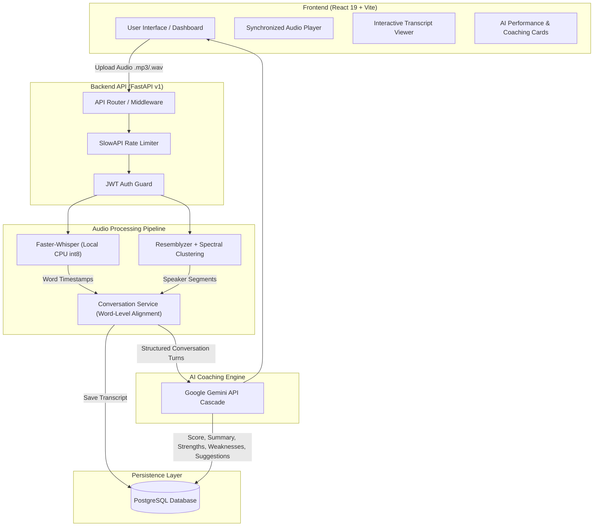

# SalesSense AI — System Architecture & Technical Design

## 1. High-Level Architecture

SalesSense AI is designed as a decoupled full-stack intelligence platform. The frontend handles interactive audio playback, waveform seeking, transcript visualization, and AI insight rendering, while the FastAPI backend orchestrates local speech-to-text, speaker diarization, turn alignment, and cloud AI evaluation.



---

## 2. Core Processing Pipeline

### Step 1: Speech-to-Text (`whisper_service.py`)
- Employs **Faster-Whisper** with `int8` quantization running on CPU.
- Uses Voice Activity Detection (VAD) with `min_silence_duration_ms=400` to filter noise and silence.
- Extracts token-level and word-level timestamps (`start`, `end`, `word`).

### Step 2: Speaker Diarization (`lightweight_diarization_service.py`)
- Resamples audio to 16 kHz mono.
- Normalizes volume without silence trimming to maintain 100% time sync with the original audio.
- Slides a 1.5-second analysis window with a 0.5-second step to generate 256-dimensional speaker embeddings via `VoiceEncoder`.
- Applies `SpectralClusterer` (2 to 4 clusters) to group embeddings into speaker labels (`SPEAKER_00`, `SPEAKER_01`).

### Step 3: Turn Merging & Temporal Alignment (`conversation_service.py`)
1. **Word-to-Speaker Mapping**: Every word token is assigned to the active speaker segment covering its midpoint.
2. **Acoustic Flicker Smoothing**: Eliminates brief single-word acoustic flickers (e.g., `A A A B A A A` -> `A`) if the inter-word pause is below 0.6 seconds.
3. **Turn Aggregation**: Contiguous words from the same speaker within a 3.0-second pause window are consolidated into natural conversational turns.

### Step 4: AI Performance Evaluation (`analysis_service.py`)
- Sends the speaker-separated conversation to Google Gemini using a multi-model fallback cascade (`gemini-flash-latest`, `gemini-flash-lite-latest`, `gemini-3.5-flash-lite`, etc.).
- Enforces strict JSON output schemas:
  - `summary`: Executive call summary.
  - `sentiment`: Customer sentiment (`Positive`, `Neutral`, `Negative`).
  - `sales_score`: 0–100 overall performance score.
  - `strengths`: 2–5 demonstrated sales strengths.
  - `weaknesses`: 2–5 areas for improvement.
  - `suggestions`: 2–5 actionable coaching recommendations.

---

## 3. Database Schema

The database is built on PostgreSQL with SQLAlchemy ORM:

```
+-------------------------------------------------------------------+
|                              users                                |
+-------------------------------------------------------------------+
| id                 SERIAL PRIMARY KEY                             |
| full_name          VARCHAR(100) NOT NULL                          |
| email              VARCHAR(255) UNIQUE NOT NULL (INDEXED)         |
| hashed_password    VARCHAR(255) NOT NULL                          |
| role               VARCHAR(50) DEFAULT 'manager'                  |
| created_at         TIMESTAMP DEFAULT CURRENT_TIMESTAMP           |
+-------------------------------------------------------------------+
                                  |
                                  | 1:N
                                  v
+-------------------------------------------------------------------+
|                          conversations                            |
+-------------------------------------------------------------------+
| id                 SERIAL PRIMARY KEY (INDEXED)                   |
| user_id            INTEGER REFERENCES users(id)                   |
| title              VARCHAR(255) DEFAULT 'Untitled Call'          |
| audio_filename     VARCHAR(255)                                   |
| duration_seconds   FLOAT                                          |
| transcript_json    TEXT                                           |
| analysis_json      TEXT                                           |
| sales_score        INTEGER                                        |
| sentiment          VARCHAR(50)                                    |
| created_at         TIMESTAMP DEFAULT CURRENT_TIMESTAMP           |
+-------------------------------------------------------------------+
```

---

## 4. Security Architecture

1. **Password Hashing**: Bcrypt with salted rounds.
2. **Authentication**: Stateless JSON Web Tokens (JWT) signed with HMAC-SHA256 and configurable expiration.
3. **Rate Limiting**: Integrated `SlowAPI` middleware to throttle compute-heavy endpoints (transcription, diarization, AI evaluation).
4. **File Upload Hardening**:
   - Secure temporary file isolation using `tempfile.NamedTemporaryFile`.
   - File extension allowlist (`.mp3`, `.wav`, `.m4a`, `.ogg`, `.flac`, `.webm`).
   - Strict 50 MB file size limit.
   - Guaranteed cleanup in `finally` blocks.
